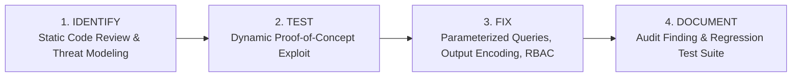

# 🛡️ Codomax Cybersecurity Internship — Module 03: Web Application Security


---

## 👨‍💻 Intern Information

- **Intern Name:** Shivam Tiwari
- **Intern ID:** CDS/INTERN/261153
- **Program:** Cybersecurity & Ethical Hacking Virtual Internship
- **Organization:** Codomax Digital Solutions
- **Module:** Module 03 — Web Application Security (Day 11 – Day 15)

---

## 🎯 Module 03 Objectives & Deliverables

1. **Web Architecture & Mechanics:** Master HTTP request/response lifecycles, stateless protocols, session tokens, and security flags (`HttpOnly`, `Secure`, `SameSite`).
2. **Authentication vs. Authorization:** Analyze identity proofing, multi-factor authentication, session fixation, and Role-Based Access Control (RBAC).
3. **OWASP Top 10 Deep Dive:** Dissect critical web flaws including SQL Injection, Reflected Cross-Site Scripting (XSS), Insecure Direct Object References (IDOR), and Security Misconfigurations.
4. **Hands-On Application Security Lab:** Implement the **`Identify -> Test -> Fix -> Document`** engineering cycle inside an isolated local sandbox.
5. **Technical Artifacts & Outreach:** Publish structured technical documentation, formal lab audit reports, an automated regression harness, and an industry showcase.

---

## 📁 Repository Directory Structure

```text
codomax-cybersecurity-module-03/
├── README.md                           # Main repository overview & lab runbook
├── LEARNING_NOTES.md                   # Comprehensive Web App Security Study Guide (Exportable)
├── LINKEDIN_POST.md                    # Ready-to-publish internship progress showcase post
├── docs/
│   └── owasp-top10-analysis.md         # In-depth architectural analysis of OWASP Top 10 risks
├── labs/
│   └── secure-web-app-lab-report.md    # Formal Identify -> Test -> Fix -> Document audit report
└── sandbox/
    ├── app.py                          # Dual-route vulnerable vs. secure educational testbed
    ├── lab.db                          # Auto-generated isolated SQLite database
    ├── requirements.txt                # Python dependencies (Flask, Werkzeug, Requests)
    ├── verify_lab.py                   # Automated regression & exploit verification test suite
    └── README.md                       # Dedicated local sandbox setup & testing manual
```

---

## ⚖️ Ethical & Authorized-Sandbox Disclaimer

> [!CAUTION]
> **LEGAL & ETHICAL MANDATE:**  
> All security testing scripts, proof-of-concept exploits, and demonstrations contained within this repository are strictly developed and executed within an authorized, isolated local loopback testbed (`127.0.0.1:5000`) on mock datasets.  
> 
> Unauthorized testing, vulnerability scanning, or exploitation against computer systems, web applications, or digital infrastructure without explicit, written permission from the asset owner is illegal and violates computer fraud regulations. The author and Codomax Digital Solutions disclaim all liability for misuse of these concepts.

---

## 🔬 Secure Web Application Lab: `Identify -> Test -> Fix -> Document`

The local sandbox contrasts four classic application security vulnerabilities against their production-grade security remediations:



| Security Class | Vulnerability Demonstrated (`/vulnerable/`) | Remediated Defense (`/secure/`) | Verified Mitigation |
| :--- | :--- | :--- | :--- |
| **SQL Injection (SQLi)** | String interpolation in SQL (`' UNION SELECT...`) | Prepared statements / parameterization (`?` binding) | Query structure immutable; input parsed as literal data |
| **Broken Authentication** | Account enumeration & plaintext passwords | PBKDF2-HMAC-SHA256 & generic error responses | Constant-time response; user harvesting neutralized |
| **Cross-Site Scripting** | Unescaped user echo in DOM (`<script>alert()</script>`) | Contextual HTML entity escaping & strict CSP | Script tags rendered as harmless text; CSP blocks execution |
| **Broken Access Control** | IDOR via URL integer tampering (`?user_id=1`) | Session-bound identity checking & RBAC | Unauthorized client requests blocked with HTTP 401 |

---

## 🚀 Running the Local Sandbox & Verification Harness

### 1. Environment Setup
Clone the repository and enter the sandbox environment:
```bash
git clone https://github.com/<your-username>/codomax-cybersecurity-module-03.git
cd codomax-cybersecurity-module-03/sandbox
```

Install the lightweight dependencies:
```bash
pip install -r requirements.txt
```

### 2. Automated Exploit & Fix Verification
Run the verification suite to execute automated tests against all four vulnerability pairs:
```bash
python verify_lab.py
```

*Expected Verification Output:*
```text
======================================================================
🛡️  CODOMAX CYBERSECURITY INTERNSHIP: MODULE 03 LAB VERIFICATION
    Intern: Ayan Mondal | ID: CDS/INT/2026/26637504
    Methodology: Identify -> Test -> Fix -> Document
======================================================================

[+] TEST 1: SQL Injection Analysis (Search Endpoint)
  [!] /vulnerable/search: EXPLOITABLE! Leaked database credentials via UNION injection.
  [✓] /secure/search: PROTECTED! Parameterized query sanitized exploit attempt.

[+] TEST 2: Authentication Failures & Account Enumeration
  [!] /vulnerable/login: EXPLOITABLE! Differentiated error reveals valid usernames.
  [✓] /secure/login: PROTECTED! Uniform error message prevents username harvesting.

[+] TEST 3: Reflected Cross-Site Scripting (XSS)
  [!] /vulnerable/feedback: EXPLOITABLE! Raw script tags reflected without HTML escaping.
  [✓] /secure/feedback: PROTECTED! Characters entity-encoded & CSP header enforced.

[+] TEST 4: Broken Access Control (Insecure Direct Object Reference - IDOR)
  [!] /vulnerable/profile: EXPLOITABLE! IDOR allows unauthorized access to Admin PII & API Secret.
  [✓] /secure/profile: PROTECTED! Unauthorized access returned 401; session isolates user records.

======================================================================
✅  ALL 4 OWASP VULNERABILITY & DEFENSE PATTERNS VERIFIED SUCCESSFULLY!
    Summary of Results: 4/4 Vulnerabilities Confirmed | 4/4 Fixes Validated
======================================================================
```

### 3. Launching the Interactive Web UI
Start the local server:
```bash
python app.py
```
Open your browser at `http://127.0.0.1:5000` to interactively explore each vulnerability and verify remediation behavior.

---

## 📑 Core Documentation Links

- [Detailed Study Guide & Notes (LEARNING_NOTES.md)](file:///c:/Users/AYAN%20MONDAL/Desktop/codomax-cybersecurity-module-03/LEARNING_NOTES.md)
- [OWASP Top 10 Deep Architectural Analysis (docs/owasp-top10-analysis.md)](file:///c:/Users/AYAN%20MONDAL/Desktop/codomax-cybersecurity-module-03/docs/owasp-top10-analysis.md)
- [Formal Lab Audit & Walkthrough Report (labs/secure-web-app-lab-report.md)](file:///c:/Users/AYAN%20MONDAL/Desktop/codomax-cybersecurity-module-03/labs/secure-web-app-lab-report.md)
- [LinkedIn Completion Showcase (LINKEDIN_POST.md)](file:///c:/Users/AYAN%20MONDAL/Desktop/codomax-cybersecurity-module-03/LINKEDIN_POST.md)

---

## 🏅 Acknowledgments

Special thanks to the technical mentors at **Codomax Digital Solutions** for structuring a rigorous, hands-on cybersecurity curriculum bridging theoretical web mechanics with practical secure software engineering.
