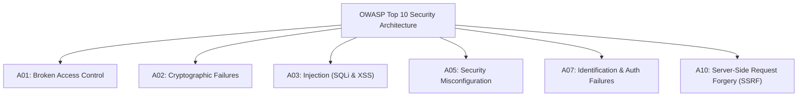

# 🛡️ OWASP Top 10 Deep Architectural Analysis & Remediation Guide

**Author:** Ayan Mondal  
**Intern ID:** CDS/INT/2026/26637504  
**Track:** Cybersecurity & Ethical Hacking  
**Module:** Module 03 — Web Application Security (Day 11 – Day 15)  
**Organization:** Codomax Digital Solutions  

---

## 📌 Executive Summary

The **Open Web Application Security Project (OWASP) Top 10** represents the authoritative global consensus on the most critical security risks facing modern web architectures. This document provides an in-depth technical analysis of these vulnerability classes, dissecting their architectural root causes, real-world attack vectors, safe sandbox testing methodologies, and concrete production-grade remediation patterns.



---

## 1. A01:2021 — Broken Access Control

### 1.1 Architectural Root Cause
Access control enforces policy such that users cannot act outside their intended permissions. Broken Access Control occurs when access checks are absent, improperly placed, or client-dependent. This vulnerability category currently occupies the #1 position on the OWASP Top 10, appearing in over 94% of tested web applications.

### 1.2 Attack Vectors & Impact
1. **Insecure Direct Object References (IDOR):** Applications expose a direct reference to an internal database key (e.g., `/api/user/1042/statement.pdf`) without validating whether the active session identity owns that record. Attackers increment or manipulate the identifier to access other users' private dossiers (horizontal privilege escalation).
2. **Missing Function Level Access Control:** Administrative administrative endpoints (e.g., `/admin/users/delete`) rely solely on hiding the link in the UI rather than validating the user's role on the backend server (vertical privilege escalation).
3. **CORS Misconfiguration:** Headers such as `Access-Control-Allow-Origin: null` or reflection of untrusted `Origin` headers combined with `Access-Control-Allow-Credentials: true`, permitting malicious third-party origins to read authenticated response data.

### 1.3 Safe Sandbox Testing Methodology
In a controlled testbed (such as `sandbox/app.py`), verify access boundaries using proxy inspection (OWASP ZAP / Burp Suite) or script automation:
1. Log in as a standard non-privileged user (User B).
2. Inspect network requests containing numeric identifiers: `GET /vulnerable/profile?user_id=2`.
3. Tamper with the parameter to target another user: `GET /vulnerable/profile?user_id=1`.
4. If the server returns User A's dossier without a `403 Forbidden` or `401 Unauthorized` response, Broken Access Control is confirmed.

### 1.4 Production Remediation Pattern
Never trust client-supplied identity parameters. Bind database operations strictly to server-side session claims:
```python
# ❌ VULNERABLE: Direct parameter trust (IDOR)
@app.route("/profile")
def view_profile():
    user_id = request.args.get("id")
    return db.query("SELECT * FROM profiles WHERE id = ?", (user_id,))

# ✅ SECURE: Session-bound record retrieval & Role-Based Access Control
@app.route("/profile")
def view_profile():
    if "user_id" not in session:
        abort(401)
    
    # User can strictly query their own authenticated identity
    authenticated_id = session["user_id"]
    return db.query("SELECT * FROM profiles WHERE id = ?", (authenticated_id,))
```

---

## 2. A02:2021 — Cryptographic Failures

### 2.1 Architectural Root Cause
Previously categorized as "Sensitive Data Exposure", this category encompasses weaknesses related to inadequate encryption, weak cryptographic primitives, improper key management, and transmission of sensitive data in cleartext.

### 2.2 Attack Vectors & Impact
1. **Plaintext Password Storage / Legacy Hashes:** Storing credentials in cleartext or utilizing obsolete algorithms (MD5, SHA-1). Compromised database dumps can be reversed within seconds using precomputed rainbow tables or GPU cracking clusters (Hashcat).
2. **Cleartext Transport:** Exposing HTTP endpoints or allowing unencrypted transmission of authentication tokens, exposing users to adversary-in-the-middle (AITM) packet sniffing.
3. **Weak Pseudo-Random Number Generation:** Generating session tokens using non-cryptographic PRNGs (e.g., Python `random.randint()`) which are mathematically predictable.

### 2.3 Safe Sandbox Testing Methodology
1. Audit database schema and examine credential columns for salt length and hash formatting.
2. Verify TLS certificate validity, protocol versions (enforcing TLS 1.2+ or 1.3), and check for the `Strict-Transport-Security` header.
3. Test session entropy by sampling sequential tokens.

### 2.4 Production Remediation Pattern
1. Hash passwords using adaptive, salted, memory-hard key derivation algorithms:
   ```python
   from werkzeug.security import generate_password_hash, check_password_hash

   # Automatically applies PBKDF2-HMAC-SHA256 with cryptographically random salt
   hashed_password = generate_password_hash(raw_user_password, method="pbkdf2:sha256:600000")
   
   # Verification in constant time
   is_valid = check_password_hash(hashed_password, submitted_password)
   ```
2. Enforce cryptographic randomness for tokens:
   ```python
   import secrets
   secure_session_token = secrets.token_hex(32)  # 256 bits of CSPRNG entropy
   ```

---

## 3. A03:2021 — Injection

### 3.1 SQL Injection (SQLi)
Injection occurs when untrusted user input is passed directly to an interpreter as part of a command or query, altering the intended logic.

#### Attack Vectors
- **Classic Boolean Injection:** `admin' OR '1'='1`
- **UNION-Based Data Harvesting:** `' UNION SELECT null, username, password_hash, null FROM users --`
- **Error-Based / Blind Injection:** Injecting payloads that induce conditional database delays (`pg_sleep()`, `WAITFOR DELAY`) to exfiltrate data bit-by-bit.

#### Safe Sandbox Testing Methodology
Submit a single quote `'` in input fields. If the application returns an unhandled database error (e.g., `sqlite3.OperationalError: near "'": syntax error`), string concatenation is present. Confirm using a UNION payload to pull rows from auxiliary tables.

#### Production Remediation Pattern
Enforce Parameterized Queries (Prepared Statements) exclusively. Input is parsed strictly as a scalar literal:
```python
# ❌ VULNERABLE: Raw SQL concatenation
cursor.execute(f"SELECT * FROM products WHERE name LIKE '%{search_term}%'")

# ✅ SECURE: Parameterized prepared statement
cursor.execute("SELECT * FROM products WHERE name LIKE ?", (f"%{search_term}%",))
```

---

### 3.2 Cross-Site Scripting (XSS)
XSS occurs when an application includes untrusted data in an HTTP response without proper validation or contextual escaping, allowing an attacker to execute arbitrary JavaScript in the victim's browser.

#### Types of XSS:
| XSS Type | Vector Location | Execution Trigger |
| :--- | :--- | :--- |
| **Reflected XSS** | HTTP Request (Query parameter, form field) | Immediate echo back in HTTP response |
| **Stored XSS** | Database (Message board, profile bio) | Persistently served to every visitor |
| **DOM-based XSS** | Client-side JavaScript (`window.location`) | Execution sink (e.g., `element.innerHTML`) |

#### Safe Sandbox Testing Methodology
Test input parameters with benign HTML probes:
```html
<script>alert('POC')</script>

```
Inspect page source to observe whether tags are rendered as executable HTML nodes or escaped text entities.

#### Production Remediation Pattern
1. **Context-Aware Output Encoding:** Escape all dynamic data prior to rendering:
   ```python
   import html
   safe_content = html.escape(untrusted_user_input)
   ```
2. **Content-Security-Policy (CSP) Defense-in-Depth:**
   ```http
   Content-Security-Policy: default-src 'self'; script-src 'self'; object-src 'none';
   ```

---

## 4. A04:2021 — Insecure Design

### 4.1 Architectural Root Cause
Insecure design represents architectural and design flaws that cannot be fixed by a simple code patch. It stems from a lack of threat modeling, architecture risk assessment, and secure design patterns early in the software development lifecycle.

### 4.2 Real-World Vectors
- **Password Reset Flaws:** Permitting password resets via easily guessable security questions ("What is your pet's name?") rather than out-of-band cryptographically signed, expiring magic links.
- **Unrestricted Resource Consumption:** Permitting unlimited PDF invoice generation or unthrottled file uploads leading to denial of service.

### 4.3 Production Remediation Pattern
- Conduct STRIDE threat modeling during system design.
- Enforce business logic boundaries and finite rate limits on all costly operations.

---

## 5. A05:2021 — Security Misconfiguration

### 5.1 Architectural Root Cause
Occurs when security controls are inaccurately configured, left at default values, or when verbose diagnostic data is exposed to public consumers.

### 5.2 Attack Vectors & Impact
1. **Default Credentials:** Leaving administrative dashboards protected by default passwords (`admin:admin`).
2. **Verbose Stack Traces:** Permitting `DEBUG = True` in production web frameworks (Django, Flask, Spring Boot). Unhandled exceptions disclose internal file paths, framework versions, and environment variables.
3. **Missing Protective HTTP Headers:** Omitting headers that harden modern browsers.

### 5.3 Production Remediation Pattern
Harden all production HTTP responses with security headers:
```http
Strict-Transport-Security: max-age=63072000; includeSubDomains; preload
X-Content-Type-Options: nosniff
X-Frame-Options: DENY
Referrer-Policy: strict-origin-when-cross-origin
Content-Security-Policy: default-src 'self';
```

---

## 6. A07:2021 — Identification and Authentication Failures

### 6.1 Architectural Root Cause
Failures in identity verification, authentication workflows, or session lifecycle controls that permit unauthorized session takeover or impersonation.

### 6.2 Attack Vectors
1. **Username Enumeration:** Error messages that disclose account existence:
   - `"User bob does not exist"` vs. `"Incorrect password for user bob"`
   - Attackers leverage this discrepancy to build lists of valid corporate emails.
2. **Credential Stuffing & Brute Force:** Automated bots testing breached credential dumps without experiencing rate limiting or progressive CAPTCHA delays.
3. **Session Fixation:** An application accepts a pre-existing session token from the user rather than regenerating a fresh session identifier upon successful login.

### 6.3 Safe Sandbox Testing Methodology
Submit valid and invalid usernames with mismatched passwords. Compare HTTP response status codes, error strings, and response timing. If discrepancies exist, enumeration is possible.

### 6.4 Production Remediation Pattern
1. Return uniform, ambiguous error responses:
   ```python
   # ✅ Uniform authentication response
   return "Invalid username or password. Please verify your credentials."
   ```
2. Regenerate session tokens on login:
   ```python
   session.clear()
   session["user_id"] = user.id
   ```
3. Set hardened cookie flags:
   ```python
   response.set_cookie("session", token, httponly=True, secure=True, samesite="Lax")
   ```

---

## 7. A10:2021 — Server-Side Request Forgery (SSRF)

### 7.1 Architectural Root Cause
SSRF occurs when a web application fetches a remote resource (e.g., importing a profile picture from a URL or executing an outgoing webhook) without validating the user-supplied destination URL.

### 7.2 Attack Vectors & Impact
1. **Cloud Metadata Exploitation:** Coercing a cloud-hosted app (AWS EC2) to query the internal metadata endpoint:
   ```
   http://169.254.169.254/latest/meta-data/iam/security-credentials/
   ```
   Exfiltrates temporary IAM role credentials, resulting in cloud infrastructure compromise.
2. **Internal Network Scanning:** Forcing the server to probe localhost (`127.0.0.1:8080`, `10.0.0.0/8`) to interact with unauthenticated microservices, Redis, or internal admin consoles.

### 7.3 Production Remediation Pattern
- Validate and restrict destination URLs using strict allow-lists of permitted domain names.
- Resolve the destination DNS IP on the server and drop any request resolving to loopback (`127.0.0.0/8`), link-local (`169.254.0.0/16`), or private RFC 1918 subnets (`10.0.0.0/8`, `172.16.0.0/12`, `192.168.0.0/16`).
- Disable HTTP redirections on server-side HTTP client requests.

---

## 8. Summary Comparison Matrix

| OWASP Risk | Common Vulnerability | Detection Vector | Key Technical Defense |
| :--- | :--- | :--- | :--- |
| **A01: Broken Access Control** | IDOR, missing backend auth check | Tampering integer IDs in query parameters | Derive user identity from session; verify RBAC |
| **A02: Cryptographic Failures** | MD5 passwords, cleartext HTTP | Inspecting DB hashes and SSL/TLS cipher suites | Salted PBKDF2 / Argon2id; TLS 1.3; HSTS |
| **A03: Injection (SQLi)** | String interpolation in queries | Inputting `' OR '1'='1` or UNION clauses | Prepared statements with parameterized bindings |
| **A03: Injection (XSS)** | Unescaped user echo in HTML | Submitting `<script>alert(1)</script>` | Contextual HTML entity escaping & strict CSP |
| **A05: Misconfiguration** | Debug mode enabled in production | Triggering 500 errors to view stack traces | Disable debug mode; configure security headers |
| **A07: Auth Failures** | Disclosing username existence | Testing invalid vs valid username responses | Uniform error messages; session regeneration |
| **A10: SSRF** | Unrestricted outgoing URL fetching | Supplying `http://169.254.169.254/` | Strict IP allow-listing; blocking private subnets |

---
*Authored for the Codomax Cybersecurity Virtual Internship (Module 03).*
