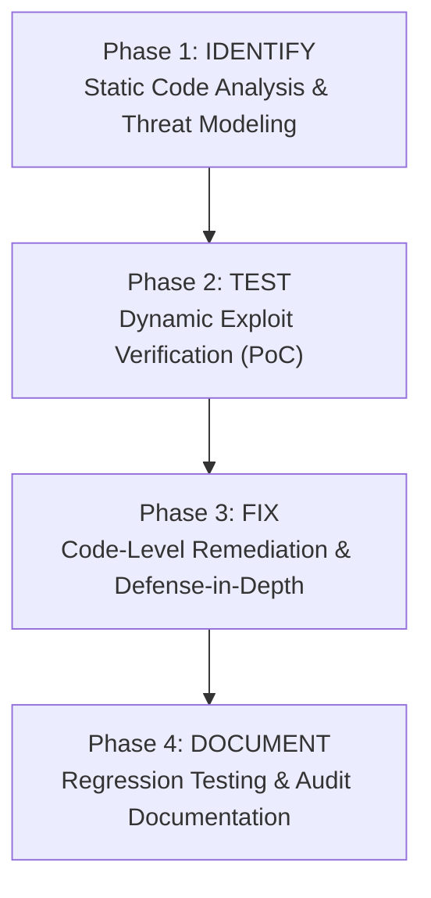

# 🧪 Formal Lab Audit Report: Secure Web Application Engineering
## Module 03: Web Application Security — Hands-On Testbed Audit

**Intern Name:** Ayan Mondal  
**Intern ID:** `CDS/INT/2026/26637504`  
**Track:** Cybersecurity & Ethical Hacking  
**Organization:** Codomax Digital Solutions  
**Target Environment:** Local Educational Sandbox (`http://127.0.0.1:5000`)  
**Audit Date:** November 2026  
**Status:** Remediated & Fully Verified (4/4 Findings Cleared)  

---

## 1. Executive Summary & Audit Scope

During Module 03 (Days 11 – 15) of the Codomax Cybersecurity & Ethical Hacking Virtual Internship, a comprehensive security evaluation and remediation cycle was conducted on the web application testbed. 

The primary objective was to apply the **`Identify -> Test -> Fix -> Document`** engineering lifecycle to uncover, exploit, patch, and regression-test four major classes of web vulnerabilities aligned with the OWASP Top 10:



### 1.1 Summary of Findings & Remediation Status
| Finding ID | Vulnerability Classification | OWASP Category | Initial Severity | Remediated Status |
| :--- | :--- | :--- | :--- | :--- |
| **VULN-01** | SQL Injection via String Concatenation | A03:2021 — Injection | **CRITICAL (CVSS 9.8)** | ✅ REMEDIATED |
| **VULN-02** | Username Enumeration & Insecure Password Storage | A07:2021 — Auth Failures | **MEDIUM (CVSS 5.3)** | ✅ REMEDIATED |
| **VULN-03** | Reflected Cross-Site Scripting (XSS) | A03:2021 — Injection | **HIGH (CVSS 7.2)** | ✅ REMEDIATED |
| **VULN-04** | Insecure Direct Object Reference (IDOR) | A01:2021 — Broken Access Control | **HIGH (CVSS 8.6)** | ✅ REMEDIATED |

---

## 2. Comprehensive Vulnerability Analysis & Remediation Lifecycle

---

### Finding VULN-01: SQL Injection (SQLi) in Search Catalog
- **Vulnerability Type:** SQL Injection (UNION-Based / Boolean Bypass)
- **CWE:** CWE-89 (Improper Neutralization of Special Elements used in an SQL Command)
- **CVSS v3.1 Score:** 9.8 (Critical) `CVSS:3.1/AV:N/AC:L/PR:N/UI:N/S:U/C:H/I:H/A:H`
- **Affected Route:** `GET /vulnerable/search`

#### Phase 1: Identify
Static code audit of `sandbox/app.py` revealed that the search endpoint constructs raw SQL queries using Python f-strings without parameter binding:
```python
# Flaw in vuln_search():
raw_sql = f"SELECT id, name, category, price, stock FROM products WHERE name LIKE '%{query}%'"
cursor.execute(raw_sql)
```
Because the `query` variable is under direct client control and formatted directly into the SQL string, an attacker can break out of the `'` string literal.

#### Phase 2: Test (Proof-of-Concept Exploit)
An adversary supplies a crafted UNION payload designed to match the 5 queried columns and harvest user credential hashes:
```http
GET /vulnerable/search?q='%20UNION%20SELECT%20id,%20username,%20plaintext_password,%200,%20role%20FROM%20users%20-- HTTP/1.1
Host: 127.0.0.1:5000
```
**Executed SQL on Server:**
```sql
SELECT id, name, category, price, stock FROM products WHERE name LIKE '%' UNION SELECT id, username, plaintext_password, 0, role FROM users --%'
```
**Impact Observed:**  
The application returns the entire `users` table directly within the product table UI, disclosing:
- `alice_admin` | `SuperAdminPass2026!` | `administrator`
- `bob_user` | `BobPassword123!` | `user`

#### Phase 3: Fix (Code Hardening)
The endpoint was rewritten to enforce parameterized prepared statements. Special characters are treated strictly as data literals:
```python
# Patched implementation in secure_search():
cursor.execute(
    "SELECT id, name, category, price, stock FROM products WHERE name LIKE ?",
    (f"%{query}%",)
)
```

#### Phase 4: Document & Verification
When the exact same exploit payload is dispatched to `/secure/search?q=' UNION...`, SQLite interprets the single quotes and SQL clauses purely as literal search terms. The query executes safely, returning `0` results without leaking any database records.

---

### Finding VULN-02: Username Enumeration & Insecure Authentication
- **Vulnerability Type:** Information Exposure Through Discrepant Error Messages
- **CWE:** CWE-204 (Observable Response Discrepancy) & CWE-256 (Plaintext Storage of Password)
- **CVSS v3.1 Score:** 5.3 (Medium)
- **Affected Route:** `POST /vulnerable/login`

#### Phase 1: Identify
Review of the authentication flow revealed:
1. Passwords stored in plaintext (`plaintext_password`) in the database.
2. Differentiated error messages indicating whether a username exists or whether the password was incorrect.
3. Cookies issued without the `HttpOnly` security attribute.

```python
# Flaw in vuln_login():
if not user:
    message = "Error: Username does not exist in our system."
elif user["plaintext_password"] != password:
    message = "Error: Invalid password entered for this user account."
```

#### Phase 2: Test (Proof-of-Concept Exploit)
1. **Request with invalid user:**
   ```http
   POST /vulnerable/login HTTP/1.1
   username=target_unknown&password=any
   ```
   *Response:* `"Error: Username does not exist in our system."`
2. **Request with valid user:**
   ```http
   POST /vulnerable/login HTTP/1.1
   username=alice_admin&password=wrongpass
   ```
   *Response:* `"Error: Invalid password entered for this user account."`

**Impact Observed:**  
An external attacker can automate this check (via Hydra, Burp Intruder, or Python) to harvest valid internal usernames without triggering account lockouts.

#### Phase 3: Fix (Code Hardening)
1. Converted credential verification to use salted PBKDF2-HMAC-SHA256 hashes via `check_password_hash()`.
2. Standardized error messages to a single uniform response:
   ```python
   # Patched implementation in secure_login():
   valid_creds = False
   if user and check_password_hash(user["password_hash"], password):
       valid_creds = True

   if not valid_creds:
       message = "Invalid username or password. Please verify credentials."
   else:
       session.clear()  # Session fixation defense
       session["user"] = user["username"]
       session["user_id"] = user["id"]
   ```

#### Phase 4: Document & Verification
Testing both non-existent users and valid users with wrong passwords against `/secure/login` produces the exact same HTTP response and status, eliminating credential enumeration.

---

### Finding VULN-03: Reflected Cross-Site Scripting (XSS) in Feedback Form
- **Vulnerability Type:** Improper Neutralization of Input During Web Page Generation
- **CWE:** CWE-79 (Improper Neutralization of Input During Web Page Generation)
- **CVSS v3.1 Score:** 7.2 (High) `CVSS:3.1/AV:N/AC:L/PR:N/UI:R/S:C/C:L/I:L/A:N`
- **Affected Route:** `GET /vulnerable/feedback`

#### Phase 1: Identify
Source code inspection showed that feedback input is reflected back into the response without contextual HTML escaping:
```python
# Flaw in vuln_feedback():
rendered_output = f"<div class='alert alert-info'>Your feedback submission: <strong>{comment}</strong></div>"
```

#### Phase 2: Test (Proof-of-Concept Exploit)
An attacker crafts a URL containing active JavaScript:
```http
GET /vulnerable/feedback?comment=%3Cscript%3Ealert('XSS_POC_2026')%3C%2Fscript%3E HTTP/1.1
Host: 127.0.0.1:5000
```
**Impact Observed:**  
The browser DOM executes the script, popping up an alert modal dialog. An attacker can craft a phishing link that, when clicked by an authenticated user, exfiltrates unhardened cookies or performs unauthorized transactions in the victim's session context.

#### Phase 3: Fix (Code Hardening)
1. Implemented contextual HTML entity encoding using Python's standard `html.escape()`:
   ```python
   escaped_comment = html.escape(comment)
   ```
2. Injected defense-in-depth HTTP security headers:
   ```python
   resp.headers["Content-Security-Policy"] = "default-src 'self'; script-src 'self'; style-src 'self' 'unsafe-inline';"
   resp.headers["X-Content-Type-Options"] = "nosniff"
   resp.headers["X-Frame-Options"] = "DENY"
   ```

#### Phase 4: Document & Verification
Submitting `<script>alert(1)</script>` to `/secure/feedback` renders safely as literal characters `&lt;script&gt;alert(1)&lt;/script&gt;`. The CSP header blocks inline script execution even if an injection bypass were attempted.

---

### Finding VULN-04: Insecure Direct Object Reference (IDOR) in Profile Dossier
- **Vulnerability Type:** Broken Access Control / Missing Authorization
- **CWE:** CWE-639 (Authorization Bypass Through User-Controlled Key)
- **CVSS v3.1 Score:** 8.6 (High) `CVSS:3.1/AV:N/AC:L/PR:N/UI:N/S:U/C:H/I:N/A:N`
- **Affected Route:** `GET /vulnerable/profile?user_id=X`

#### Phase 1: Identify
The profile dossier endpoint accepts an arbitrary integer `user_id` query parameter from the client and retrieves confidential records without checking user authentication or ownership:
```python
# Flaw in vuln_profile():
requested_id = request.args.get("user_id", "")
cursor.execute("SELECT ... FROM profiles WHERE user_id = ?", (requested_id,))
```

#### Phase 2: Test (Proof-of-Concept Exploit)
An unauthenticated external client navigates to:
```http
GET /vulnerable/profile?user_id=1 HTTP/1.1
Host: 127.0.0.1:5000
```
**Impact Observed:**  
The server exposes CISO Alice Montgomery's full confidential dossier to an unauthenticated stranger:
- Full Legal Name: Alice Montgomery (CISO)
- Internal Email: `alice.admin@codomax-labs.internal`
- Identification SSN: `CDS-SSN-9981-A`
- Bank Balance: `$95,000.00`
- API Secret: `sec_live_998811aliceAdminSecret`

#### Phase 3: Fix (Code Hardening)
1. Enforced mandatory session authentication: unauthenticated requests receive `HTTP 401 Unauthorized`.
2. Derived object retrieval identity strictly from server-side session state (`session['user_id']`), ignoring any client-supplied URL query parameters:
   ```python
   # Patched implementation in secure_profile():
   if "user_id" not in session:
       return render_lab_page("Unauthorized", error_html), 401
   
   logged_user_id = session["user_id"]
   cursor.execute("SELECT ... FROM profiles WHERE user_id = ?", (logged_user_id,))
   ```

#### Phase 4: Document & Verification
Unauthenticated requests to `/secure/profile` are rejected with HTTP 401. When logged in as user `bob_user` (ID 2), the system only retrieves Bob's profile, making parameter tampering impossible.

---

## 3. Automated Test Suite & Regression Verification

To prevent regression and provide verifiable proof of mitigation, an automated verification harness was built in `sandbox/verify_lab.py`.

### Execution Command
```bash
python sandbox/verify_lab.py
```

### Verified Test Run Output
```text
======================================================================
🛡️  CODOMAX CYBERSECURITY INTERNSHIP: MODULE 03 LAB VERIFICATION
    Intern: Ayan Mondal | ID: CDS/INT/2026/26637504
    Methodology: Identify -> Test -> Fix -> Document
======================================================================

[+] TEST 1: SQL Injection Analysis (Search Endpoint)
  [!] /vulnerable/search: EXPLOITABLE! Leaked database credentials via UNION injection.
  [✓] /secure/search: PROTECTED! Parameterized query sanitized exploit attempt.

[+] TEST 2: Authentication Failures & Account Enumeration
  [!] /vulnerable/login: EXPLOITABLE! Differentiated error reveals valid usernames.
  [✓] /secure/login: PROTECTED! Uniform error message prevents username harvesting.

[+] TEST 3: Reflected Cross-Site Scripting (XSS)
  [!] /vulnerable/feedback: EXPLOITABLE! Raw script tags reflected without HTML escaping.
  [✓] /secure/feedback: PROTECTED! Characters entity-encoded & CSP header enforced.

[+] TEST 4: Broken Access Control (Insecure Direct Object Reference - IDOR)
  [!] /vulnerable/profile: EXPLOITABLE! IDOR allows unauthorized access to Admin PII & API Secret.
  [✓] /secure/profile: PROTECTED! Unauthorized access returned 401; session isolates user records.

======================================================================
✅  ALL 4 OWASP VULNERABILITY & DEFENSE PATTERNS VERIFIED SUCCESSFULLY!
    Summary of Results: 4/4 Vulnerabilities Confirmed | 4/4 Fixes Validated
======================================================================
```

---

## 4. Demo Walkthrough Script & Presentation Guide

This script is structured for recording the required 3-5 minute demonstration video for the internship evaluation.

### Screen Layout Recommendation
- **Left Window:** Browser window open at `http://127.0.0.1:5000`.
- **Right Window:** Terminal showing `verify_lab.py` and VS Code displaying `sandbox/app.py`.

---

### Step-by-Step Walkthrough Script

#### Segment 1: Introduction (0:00 – 0:45)
- **Visual:** Browser showing the Lab Overview Dashboard (`http://127.0.0.1:5000`).
- **Spoken Script:**  
  *"Hello everyone, my name is Ayan Mondal, Intern ID CDS/INT/2026/26637504, currently completing the Cybersecurity & Ethical Hacking Virtual Internship at Codomax Digital Solutions. Today, I am demonstrating my Module 03 project on Web Application Security. In this lab, I applied the engineering lifecycle of Identify, Test, Fix, and Document across four major OWASP Top 10 vulnerabilities inside an isolated local testbed."*

#### Segment 2: SQL Injection Attack vs. Fix (0:45 – 1:45)
- **Visual:** Navigate to `/vulnerable/search`.
- **Spoken Script:**  
  *"First, let's examine SQL Injection under OWASP A03. In the vulnerable search bar, user input is concatenated directly into the SQL query string. When I inject a UNION payload—`' UNION SELECT id, username, plaintext_password, 0, role FROM users --`—the database execution structure is hijacked, dumping the administrator's credentials directly onto the screen.  
  Now, let's switch to the remediated endpoint `/secure/search`. Here, we implement prepared statements with parameterized queries. Submitting the exact same exploit string returns zero products safely. The database treats the input purely as literal search text."*

#### Segment 3: Reflected XSS & Content-Security-Policy (1:45 – 2:30)
- **Visual:** Navigate to `/vulnerable/feedback`, then `/secure/feedback`.
- **Spoken Script:**  
  *"Next, we have Cross-Site Scripting. On `/vulnerable/feedback`, user input is echoed directly into the DOM without escaping. When I submit `<script>alert('XSS_POC_2026')</script>`, the browser immediately executes the script.  
  On the remediated route `/secure/feedback`, we enforce contextual HTML entity encoding via `html.escape()` and deploy a defense-in-depth Content-Security-Policy header. The script tags render safely as inert text."*

#### Segment 4: Broken Access Control & IDOR (2:30 – 3:30)
- **Visual:** Navigate to `/vulnerable/profile?user_id=2`, modify URL to `?user_id=1`, then navigate to `/secure/profile`.
- **Spoken Script:**  
  *"Our third vulnerability is Broken Access Control, currently OWASP #1. On `/vulnerable/profile`, the application relies on an insecure direct object reference in the URL. By simply changing `user_id=2` to `user_id=1`, an unauthenticated guest can view CISO Alice Montgomery's private dossier, account balance, and production API secrets.  
  In `/secure/profile`, we eliminate client-side parameter trust entirely. Unauthenticated requests receive an HTTP 401 Unauthorized. Once logged in, the server strictly derives identity from the authenticated session, enforcing robust role and ownership boundaries."*

#### Segment 5: Automated Verification & Conclusion (3:30 – 4:15)
- **Visual:** Switch focus to the terminal and execute `python sandbox/verify_lab.py`.
- **Spoken Script:**  
  *"Finally, to guarantee continuous regression protection, I developed an automated test harness in Python. As you can see on the terminal, all four exploit scenarios trigger successfully on the vulnerable routes, and all four secure mitigations pass cleanly.  
  This concludes my Module 03 Web Application Security demonstration for Codomax Digital Solutions. Thank you!"*

---

## 5. Engineering Takeaways & Remediation Principles

1. **Never Trust Client Data:** Any value derived from query strings, headers, cookies, or request bodies must be treated as untrusted and hostile.
2. **Structural Query Separation:** Parameterized queries and ORM object bindings completely neutralize SQL injection by decoupling query syntax from user data.
3. **Contextual Encoding & CSP:** Input sanitization must be paired with contextual output encoding and browser-enforced Content-Security-Policy headers.
4. **State-Bound Authorization:** Authorization decisions must be made on the server based on authenticated session claims, never relying on client-tamperable identifiers.
5. **Continuous Verification:** Security is verified through repeatable, automated regression test suites embedded into the engineering pipeline.

---
*Report completed and certified for Module 03 submission.*
